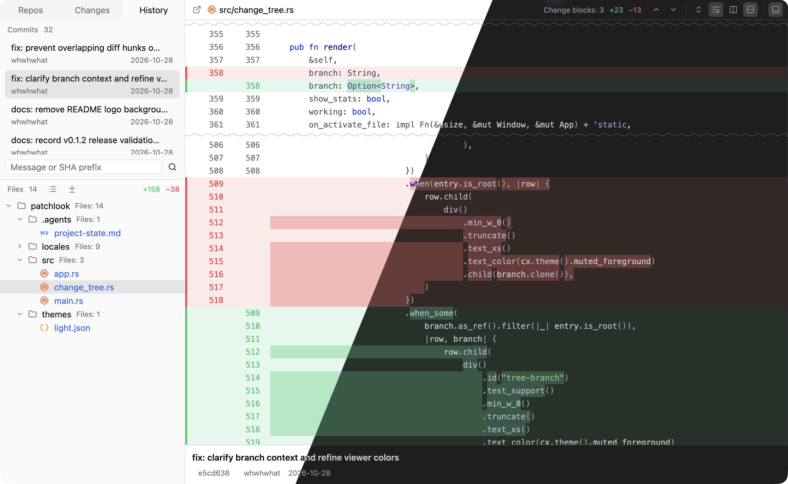

<p align="center">
  
</p>

<h1 align="center">Patchlook</h1>

<p align="center"><a href="README.md">English</a> · 简体中文</p>

<p align="center">适用于 macOS、Windows 和 Linux 的原生只读 Git 查看器。</p>

<p align="center">
  <a href="https://github.com/worldtheater/patchlook/releases">下载发行版</a> ·
  <a href="#从源码构建">从源码构建</a> ·
  <a href="https://github.com/worldtheater/patchlook/issues">反馈问题</a>
</p>

查看本地改动、浏览提交历史、对比文件版本，不改变工作区、暂存区或分支。



## 功能

- **查看改动** — 浏览已暂存、未暂存及未跟踪的文件，查看新增和删除行数。
- **浏览历史** — 查看分支和提交，按提交说明或 SHA 前缀搜索整个分支的历史。
- **对比代码** — 切换并排或行内 diff，支持语法高亮和行内差异高亮。
- **聚焦变化** — 折叠未修改的内容、自动换行，或同步滚动前后两个版本。
- **对比图片** — 并排预览前后版本，适应窗口大小，或缩放、平移查看细节。
- **使用外部程序打开** — 从文件标题栏选择系统推荐的应用或其他程序，打开工作区中的最新文件；对于已删除文件，打开删除前版本的临时副本。
- **个性化设置** — 支持浅色、暗色和跟随系统主题，提供九种界面语言。

## 安装

前往 [Releases](https://github.com/worldtheater/patchlook/releases) 下载已发布的安装包，也可以[从源码构建](#从源码构建)。

| 平台 | 系统要求 | 安装方式 |
| --- | --- | --- |
| macOS | macOS 15 及以上，Apple Silicon | 打开 DMG，将 **Patchlook** 拖入 **Applications（应用程序）**。 |
| Windows | Windows 10 及以上，x64 | 解压 ZIP，运行 `patchlook.exe`。 |
| Linux | x86_64，X11 或 Wayland，支持 Vulkan 的显卡 | 解压 tar.gz，运行 `./patchlook`。 |

需要安装 [Git](https://git-scm.com/downloads)，并确保可通过 `PATH` 找到。macOS 正式发行版已完成签名和公证。Linux 安装包在 Ubuntu 24.04 上构建，需要兼容的系统库。

## 快速开始

1. 点击 **打开仓库（Open repository）**，选择本地 Git 仓库。
2. 在 **改动（Changes）** 中查看工作区和暂存区的变化，在 **历史（History）** 中浏览提交。
3. 在 **仓库（Repos）** 中切换仓库或浏览其他分支。

使用其他工具修改仓库后，点击刷新以更新内容。分支浏览使用本地 Git 引用；需要获取远端更新时，请使用你常用的 Git 客户端。

文本 diff 要求文件使用 UTF-8 编码。支持的图片格式会显示预览，其他二进制文件仅列出变更信息，不显示内容差异。

## 快捷键

| 操作 | macOS | Windows / Linux |
| --- | --- | --- |
| 打开仓库 | `⌘ O` | `Ctrl O` |
| 刷新 | `⌘ R` / `F5` | `Ctrl R` / `F5` |
| 复制所选内容 | `⌘ C` | `Ctrl C` |
| 全选当前 diff 面板中的内容 | `⌘ A` | `Ctrl A` |
| 在文件树中导航 | 方向键 | 方向键 |
| 退出 | `⌘ Q` | `Ctrl Q` |

## 从源码构建

安装 Rust 1.95 及以上版本、Git 和[对应平台的构建依赖](https://github.com/worldtheater/patchlook/blob/main/docs/development.md#prerequisites)，然后运行：

```sh
git clone https://github.com/worldtheater/patchlook.git
cd patchlook
cargo run --locked --release
```

测试、打包、发布及 GPUI Kit 补丁的说明见[开发指南](https://github.com/worldtheater/patchlook/blob/main/docs/development.md)（英文）。

使用 [Rust](https://www.rust-lang.org/) 和 [GPUI Kit](https://github.com/longbridge/gpui-kit) 构建。

采用 [MIT 开源协议](LICENSE)。

## 友情链接

[LINUX DO](https://linux.do/) 是一个交流技术、分享开源项目的社区。欢迎来这里发现有趣的工具，分享自己的作品和使用心得。
